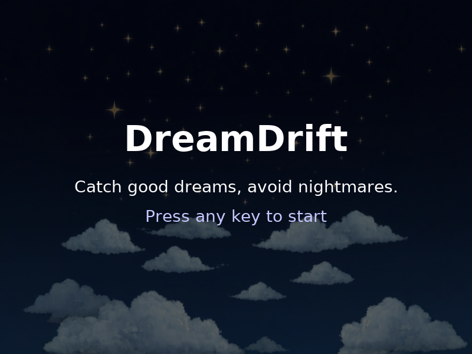

# DreamDrift

Catch good dreams. Avoid nightmares.

DreamDrift is a 2D arcade game I built with Python and Pygame for my Python course at Ruppin Academic Center. Move Alice through a dream world, collect moons and dreamcatchers, and avoid alarm clocks and storm clouds.



## Gameplay

- Collect a moon or dreamcatcher to earn one point.
- Avoid alarm clocks and storm clouds: each collision costs one life.
- Start with three lives and try to achieve your highest score.
- Progress through six difficulty levels, advancing every ten points.
- Level changes trigger extra objects. At the maximum level, additional bursts arrive at random intervals of 10–15 seconds.

Objects rise from the bottom of the screen. The game includes randomized spawning, distance-based collision detection, a score and lives display, background music, sound effects, and restart support.

## Run locally

Requires Python 3.10 or newer and a desktop environment with a display and audio support. The original project used Python 3.12 and Pygame 2.6.1.

From the project folder:

```bash
python -m venv .venv
```

Activate the environment:

**Windows (Command Prompt)**

```bat
.venv\Scripts\activate
```

**macOS / Linux**

```bash
source .venv/bin/activate
```

Install the dependency and launch the game:

```bash
python -m pip install -r requirements.txt
python main.py
```

Run the commands from the folder containing `main.py` so the game can find its assets.

## Controls

| Key | Action |
| --- | --- |
| Any key on the start screen | Start playing |
| Arrow keys | Move Alice |
| M during gameplay | Mute or unmute music and sound effects |
| R on the game-over screen | Restart |
| Q on the game-over screen | Quit |
| Close the game window | Quit |

Sound is enabled when the game starts.

## Files

| Path | Contents |
| --- | --- |
| `main.py` | Game loop, menus, player controls, objects, collisions, scoring, and audio |
| `assets/images/` | Background, player, and collectible / obstacle images |
| `assets/sounds/` | Background music and sound effects |
| `requirements.txt` | Pygame dependency |

## Built with

Python and Pygame. Other imports (`sys`, `os`, `random`, and `time`) are part of Python's standard library.

## Credits

Developed by Rayan Suan.

Graphics were created using AI tools. Sound effects were sourced from [Pixabay](https://pixabay.com/sound-effects/) and [Mixkit](https://mixkit.co/free-sound-effects/), as credited in the original project README.
